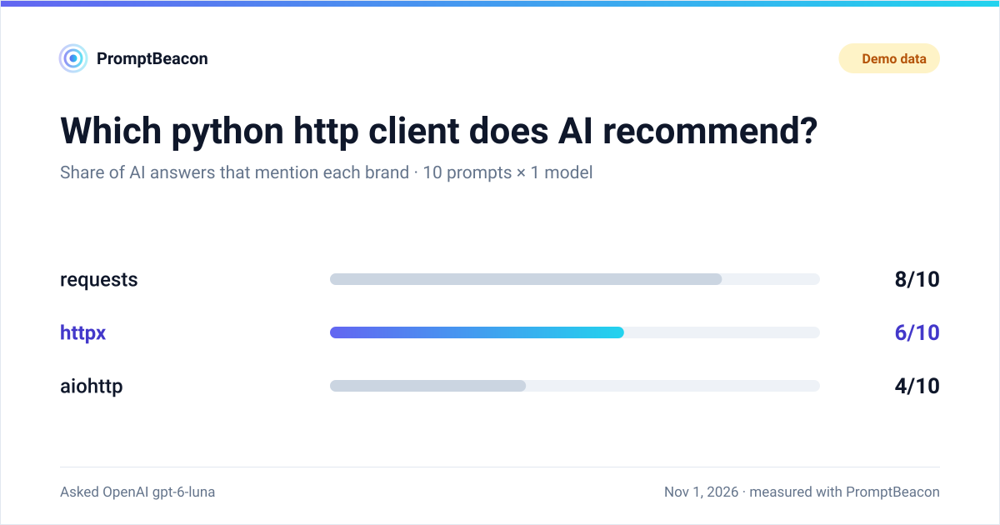

<p align="center">
  <picture>
    <source media="(prefers-color-scheme: dark)" srcset="assets/logo-dark.svg">
    
  </picture>
</p>

<p align="center">
  <b>Does AI recommend your library or dev product?</b><br>
  PromptBeacon asks ChatGPT, Claude, Gemini or a local model the questions your users ask,
  and turns the answers into a number you can gate in CI and show as a README badge.
</p>

<p align="center">
  <a href="https://pypi.org/project/promptbeacon/"></a>
  <a href="https://github.com/yotambraun/promptbeacon/actions/workflows/ci.yml"></a>
  <a href="https://www.python.org/downloads/"></a>
  <a href="LICENSE"></a>
  <a href="https://yotambraun.github.io/promptbeacon/"></a>
</p>

<p align="center">
  Use it from:
  <a href="#try-it-in-10-seconds-no-api-key">CLI</a> ·
  <a href="#in-python">Python</a> ·
  <a href="#in-ci-pytest-and-the-github-action">pytest</a> ·
  <a href="#in-ci-pytest-and-the-github-action">GitHub Action</a> ·
  <a href="#from-claude-code-or-any-mcp-client">MCP / Claude Code</a>
</p>

---

## Try it in 10 seconds, no API key

```bash
pip install promptbeacon
promptbeacon demo httpx --category "python http client" -c requests -c aiohttp
```

Real output (excerpt; the full report adds a score breakdown, cited domains and a
competitor table):

```text
Running in DEMO mode — canned data, no API calls.

╭────────────────────────── Visibility Score: httpx ───────────────────────────╮
│ 79.0 / 100                                                                   │
╰─────────────────────── Generated: 2026-11-01 20:05:52 ───────────────────────╯
measurement: demo — Demo data — canned responses, not a real measurement.
prompts: 10 · category: python http client
...

Share of Voice: 33% (rank 2, 60% of prompts)
                   Share of Voice                    
┏━━━━━━━━━━┳━━━━━━━━━━━━┳━━━━━━━━━━┳━━━━━━━━━━━━━━━━┓
┃ Brand    ┃ Appears In ┃ Presence ┃ Share of Voice ┃
┡━━━━━━━━━━╇━━━━━━━━━━━━╇━━━━━━━━━━╇━━━━━━━━━━━━━━━━┩
│ requests │ 8/10       │ 80%      │ 44%            │
│ httpx    │ 6/10       │ 60%      │ 33%            │
│ aiohttp  │ 4/10       │ 40%      │ 22%            │
└──────────┴────────────┴──────────┴────────────────┘
```

`demo` runs the whole pipeline on canned answers built from your inputs, costs nothing,
and labels every result `measurement: demo`. For a real measurement, set an API key and
run `promptbeacon scan` with the same arguments.

## Put the result in your README

One scan produces a badge and a 1200×630 share card (SVG in light and dark, PNG for
networks that need it):

```bash
promptbeacon scan httpx -t "python http client" -c requests -c aiohttp -f json > report.json
promptbeacon badge --report report.json --endpoint .promptbeacon/badge.json
promptbeacon card  --report report.json --theme both --png card.png
```

<p align="center">
  
</p>

<p align="center">
  <picture>
    <source media="(prefers-color-scheme: dark)" srcset="assets/card-dark.svg">
    
  </picture>
</p>

Both images are unedited output of the demo command above, and say so. The
[weekly workflow template](examples/workflows/ai-visibility-weekly.yml) re-scans and
commits a fresh badge; see [Badges & share cards](https://yotambraun.github.io/promptbeacon/share/).

> **Which tool?**
> **PromptBeacon** is for developers and open-source maintainers: does AI recommend your
> library or dev product — a number in CI and a README badge.
> **[Saylent](https://github.com/yotambraun/saylent)** (npm `saylent`) is for brand and
> website teams: an audit of what AI assistants say about your site, with the answers and
> cited pages as receipts, plus fixes for your site.

## Real scans: keys and models

```bash
export OPENAI_API_KEY="sk-..."      # or ANTHROPIC_API_KEY, GEMINI_API_KEY, ...
promptbeacon providers              # which keys are set, and which model each provider uses
promptbeacon scan httpx -t "python http client" -c requests -c aiohttp -p openai -p anthropic
```

Keys are read from the environment or a `.env` file. Each provider has a low-cost default
model; choose another per provider with `--model provider=model_id` (repeatable), with
`PROMPTBEACON_<PROVIDER>_MODEL`, or with `Beacon.with_models()` in Python:

```bash
promptbeacon scan httpx -t "python http client" -m anthropic=claude-sonnet-5-5 -m openai=gpt-6-sol
```

| Provider (`-p`) | Default model | API key variable |
|-----------------|---------------|------------------|
| `openai` | `gpt-6-luna` | `OPENAI_API_KEY` |
| `anthropic` | `claude-haiku-5-5` | `ANTHROPIC_API_KEY` |
| `google` | `gemini-3.5-flash-lite` | `GOOGLE_API_KEY` or `GEMINI_API_KEY` |
| `mistral` | `mistral-small-latest` | `MISTRAL_API_KEY` |
| `cohere` | `command-r7b-12-2024` | `COHERE_API_KEY` |
| `perplexity` | `sonar` | `PERPLEXITY_API_KEY` |
| `litellm` | none: any [LiteLLM model](https://docs.litellm.ai/docs/providers) you set | read by LiteLLM |

Providers you name with `--model` are the ones queried when you don't pass `-p`. Defaults
change between releases, so pin `--model` (or a [protocol](https://yotambraun.github.io/promptbeacon/advanced/)) when
you track a trend. Costs are estimated from LiteLLM's price map.

### Local models (Ollama)

The `litellm` slot takes any LiteLLM model string, so a local model needs no API key:

```bash
ollama pull llama3.2
promptbeacon scan httpx -t "python http client" -c requests --model litellm=ollama/llama3.2
```

OpenRouter, Azure, Bedrock or a vLLM server work the same way, for example
`--model litellm=openrouter/<model>` with `OPENROUTER_API_KEY` set. See
[Models & local LLMs](https://yotambraun.github.io/promptbeacon/models/).

## In Python

```python
from promptbeacon import Beacon

report = (
    Beacon("httpx")
    .with_category("python http client")
    .with_competitors("requests", "aiohttp")
    .demo()  # keyless; remove for a real scan
    .scan()
)

print(f"Visibility:     {report.visibility_score:.0f}/100")
print(f"Share of voice: {report.share_of_voice.target_share:.0%}")
print(f"Rank:           {report.share_of_voice.target_rank}")
```

For a real scan, drop `.demo()` and optionally choose models:
`.with_models({"anthropic": "claude-sonnet-5-5"})` or `.with_models(litellm="ollama/llama3.2")`.

The category is what makes a scan meaningful: prompts become real questions such as
"Which python http client would you recommend?". Without one, PromptBeacon asks "alternatives to
&lt;competitor&gt;" questions when you give competitors, and otherwise warns you.
`.with_category_inference()` (CLI: `--infer-category`) can name it with one model call.

## In CI: pytest and the GitHub Action

```yaml
- uses: yotambraun/promptbeacon@v1
  id: beacon
  with:
    brand: "httpx"
    category: "python http client"
    competitors: |
      requests
      aiohttp
    models: |
      openai=gpt-6-luna
    min-share-of-voice: "0.3"
    comment-on-pr: "true"   # needs permissions: pull-requests: write
  env:
    OPENAI_API_KEY: ${{ secrets.OPENAI_API_KEY }}
- run: echo "Score ${{ steps.beacon.outputs.score }}, SoV ${{ steps.beacon.outputs.share-of-voice }}"
```

The Action exposes `score`, `share-of-voice`, `rank`, `presence`, `stability`, `tier`,
`passed` and `report-path`, writes a job summary, and applies the thresholds last, so a
failing check still reports its numbers. Outside GitHub,
`promptbeacon ci --report report.json --min-score 50` does the same.

```python
# pytest plugin: auto-registers, and skips cleanly when no key is configured
import pytest


@pytest.mark.visibility(
    brand="httpx",
    categories=["python http client"],
    competitors=["requests"],
    models={"openai": "gpt-6-luna"},
    min_score=40,
)
def test_httpx_is_visible(): ...
```

Or in plain code: `report.assert_visibility(min_score=50, min_share_of_voice=0.3)`.

## From Claude Code or any MCP client

```bash
claude mcp add promptbeacon -- uvx --from 'promptbeacon[mcp]' promptbeacon mcp
```

Or install the plugin, which adds the server and three skills (`ai-visibility`,
`share-card`, `visibility-ci`):

```text
/plugin marketplace add yotambraun/promptbeacon
/plugin install promptbeacon@promptbeacon
```

Then ask: *"Does AI recommend this project? Compare it with its main alternatives."* The
tools (`scan`, `project_scan`, `sources`, `share_assets`, `providers`) return JSON and
accept an optional `models` argument. With no key configured they use the demo and say
so. See [Claude Code & MCP](https://yotambraun.github.io/promptbeacon/mcp/).

## Open-source projects

```bash
promptbeacon scan --repo encode/httpx        # GitHub
promptbeacon scan --pypi httpx               # PyPI
promptbeacon scan --npm express              # npm
```

PromptBeacon reads the project's public description, topics and README, guesses a category
("python http client") and the projects the README compares itself to, prints both with
where they came from, and scans with developer-oriented prompts. `--category` and
`--competitor` always win. In Python: `Beacon.from_project("pypi:httpx")`.

## Measuring it properly

- **Share of voice**: of all mentions of you and your competitors, how many are yours, and
  your rank.
- **Stability**: answers vary between runs. `--stability 5` repeats each prompt and
  reports a 0–100 stability score, a confidence interval and the prompts that flip-flop.
- **Web-grounded answers**: a plain model call reflects training memory. `--grounded`
  uses each provider's own web search (OpenAI, Anthropic, Gemini, Perplexity) and records
  the pages it cites (`pip install 'promptbeacon[grounded]'`).
- **Sources**: `promptbeacon sources` ranks the domains AI answers cite for your category
  and flags which ones cite you.
- **Funnel**: `promptbeacon funnel` models agentic search (fan-out, retrieve, rerank,
  cite) and shows the stage where you drop out.
- **Honest labels**: every report says how it was measured (`demo`, `base_model` or
  `api_grounded`), which models answered, and how complete its cost estimate is.

## CLI

```bash
promptbeacon demo httpx -t "python http client"              # keyless, instant
promptbeacon scan httpx -t "python http client" -c requests -p openai -p anthropic
promptbeacon scan httpx -t "python http client" -m litellm=ollama/llama3.2   # local model
promptbeacon scan --repo encode/httpx                        # an open-source project
promptbeacon scan httpx -t "python http client" --grounded   # web-grounded answers
promptbeacon scan httpx -t "python http client" --stability 5
promptbeacon scan httpx -t "python http client" --assert-min-score 50   # CI gate
promptbeacon scan --protocol protocol.json                   # pinned, reproducible run
promptbeacon badge httpx -t "python http client" --demo      # README badge
promptbeacon card httpx -t "python http client" --demo --png card.png
promptbeacon ci --report report.json --min-sov 0.3           # summary + gate, any CI
# also: sources, funnel, dashboard, compare, history, providers, mcp
```

`--format` accepts `text`, `json`, `markdown`, `csv` and `html`. Machine formats go to
stdout and notices to stderr, so `promptbeacon scan ... -f json | jq` works. Real CLI scans
are saved to a local DuckDB file (`~/.promptbeacon/data.db`) for `promptbeacon history`;
nothing leaves your machine except the model requests.

Also included: an HTML [dashboard](assets/sample-dashboard.html), smart LLM-based
extraction (`--smart`), and `BeaconGuard`, which flags chatbot replies that recommend a
competitor ([Advanced](https://yotambraun.github.io/promptbeacon/advanced/)).

## Who it's for

- **Open-source maintainers and developer-tool teams**: does ChatGPT recommend *your*
  library, and is that changing?
- **Indie developers and technical founders**: your product's AI visibility, in code and CI.
- **AI and eval engineers**: brand visibility as a check next to your other evals.

Brand, marketing and website teams auditing what assistants say about a site are better
served by [Saylent](https://github.com/yotambraun/saylent).

## Documentation

**[yotambraun.github.io/promptbeacon](https://yotambraun.github.io/promptbeacon/)**:
[Quickstart](https://yotambraun.github.io/promptbeacon/quickstart/) ·
[Models & local LLMs](https://yotambraun.github.io/promptbeacon/models/) ·
[CLI](https://yotambraun.github.io/promptbeacon/cli/) ·
[Open-source projects](https://yotambraun.github.io/promptbeacon/projects/) ·
[Badges & cards](https://yotambraun.github.io/promptbeacon/share/) ·
[CI & examples](https://yotambraun.github.io/promptbeacon/examples/) ·
[Claude Code & MCP](https://yotambraun.github.io/promptbeacon/mcp/) ·
[API reference](https://yotambraun.github.io/promptbeacon/api-reference/)

## Contributing

Contributions are welcome. [CONTRIBUTING.md](CONTRIBUTING.md) covers setup
(`uv sync --all-extras`), tests, lint and types; [TODO.md](TODO.md) lists ideas. See
[CHANGELOG.md](CHANGELOG.md) for what changed in each release.

## License

Apache License 2.0. See [LICENSE](LICENSE).

Built with [LiteLLM](https://github.com/BerriAI/litellm), [Pydantic](https://docs.pydantic.dev/),
[DuckDB](https://duckdb.org/), [Typer](https://typer.tiangolo.com/), [Rich](https://rich.readthedocs.io/)
and the [MCP Python SDK](https://github.com/modelcontextprotocol/python-sdk).
