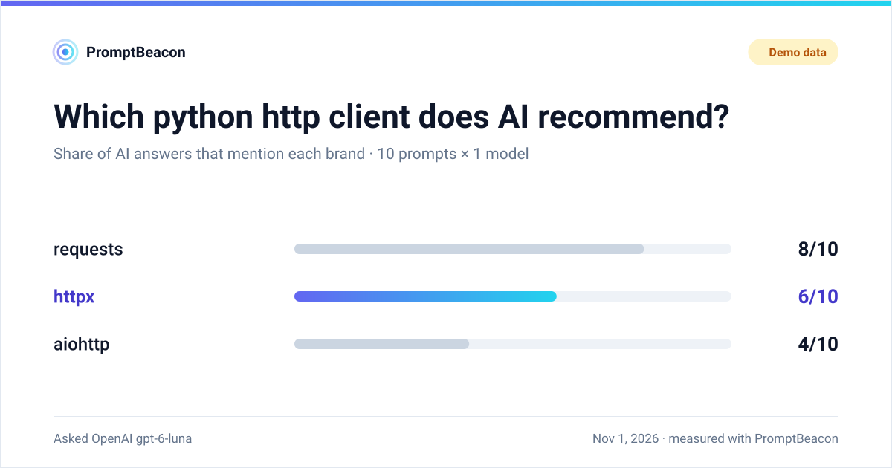

# Badges & share cards

Two ways to show a result: a small **badge** for a README, and a 1200x630 **card** for
a README, a blog post or a social network. Both are generated locally from a scan
report. Nothing is uploaded anywhere.

<p align="center">
  
</p>

## Scan once, render many

Every output can be produced from one saved report, so you pay for the scan once:

```bash
promptbeacon scan "Nike" -t "running shoes" -c "Adidas" -c "New Balance" \
  -f json --no-save > report.json

promptbeacon badge --report report.json -o .promptbeacon/badge.svg \
  --endpoint .promptbeacon/badge.json
promptbeacon card --report report.json -o .promptbeacon/card.svg --theme both
```

`badge` and `card` can also run the scan themselves, with the same options as `scan`
(including `--repo`, `--pypi`, `--npm`, `--model` and `--demo`):

```bash
promptbeacon card "Nike" -t "running shoes" -c "Adidas" -c "Hoka" --demo
promptbeacon badge --pypi httpx
```

## Badge

<p>
  
</p>

The badge shows the visibility score and share of voice (`--metric both`, the
default), or only one of them (`--metric score`, `--metric sov`); `--metric rank` is
described below. Its color follows the score: green from 70, amber from 40, red below.
A badge made from demo data reads `AI visibility · demo` and is grey.

There are two ways to put it in a README.

**Commit the SVG** (no third-party service):

```markdown
[](https://github.com/yotambraun/promptbeacon)
```

**Use shields.io**, which renders a badge from a small JSON file
([endpoint badge](https://shields.io/badges/endpoint-badge)). `--endpoint` writes that
file; commit it and point shields.io at its raw URL, URL-encoded:

```markdown
[](https://github.com/yotambraun/promptbeacon)
```

The JSON follows the endpoint schema: `schemaVersion` (always `1`), `label`, `message`,
and optional `color`, `labelColor` and `logoSvg`:

```json
{
  "schemaVersion": 1,
  "label": "AI visibility",
  "message": "62/100 · SoV 34%",
  "color": "b45309",
  "labelColor": "1e293b",
  "logoSvg": "<svg …>"
}
```

shields.io caches endpoint badges, so a refreshed file can take a few minutes to show.

### Rank in your category

`--metric rank` shows where you stand among the projects the scan compared, ranked by
how many answers mention each one:

```bash
promptbeacon scan httpx -t "python http client" -c requests -c aiohttp -c urllib3 \
  -f json --no-save > report.json
promptbeacon badge --report report.json --metric rank \
  -o .promptbeacon/rank.svg --endpoint .promptbeacon/rank.json
```

The badge reads `AI rank | #2 of 4 · python http clients` (`tied #2 of 4` when another
project has the same count). It needs a category and at least two competitors, and the
command says how to fix it otherwise. The rank is a position, not a grade, so the badge
has one neutral color; a rank from demo data reads `AI rank · demo` and is grey, and a
scan cut short by `--max-cost` reads `· partial`. The rank only covers the projects you
compared: name the real alternatives, or use the
[AI Recommendation Index](recommendation-index.md) once it is published.

In Python:

```python
from promptbeacon import Beacon
from promptbeacon.share import badge_endpoint, render_badge_svg, shields_url

report = (
    Beacon("Nike")
    .demo()
    .with_category("running shoes")
    .with_competitors("Adidas", "New Balance")
    .scan()
)
svg = render_badge_svg(report)
endpoint = badge_endpoint(report, metric="both")
rank = badge_endpoint(report, label="AI rank", metric="rank")  # needs 2+ competitors
url = shields_url(
    "https://raw.githubusercontent.com/OWNER/REPO/main/.promptbeacon/badge.json"
)
```

## Share card

The card answers one question: in how many answers does each brand appear? It shows up
to six brands (yours is always included and highlighted), the category, how many
prompts and models were used, the date, and how the scan was measured (**Demo data**,
**Base model** or **Web-grounded**).

It is designed to stay readable with long names, many competitors, non-Latin text and
extreme values. It uses system fonts and no scripts, so it renders the same in a
README, a docs page or a browser.

### Light and dark

`--theme both` writes `card.svg` and `card-dark.svg`. GitHub picks the right one with a
`<picture>` element:

```html
<picture>
  <source media="(prefers-color-scheme: dark)" srcset=".promptbeacon/card-dark.svg">
  
</picture>
```

### Score trend

Once there are at least three real scans of the same kind (same measurement tier and
category), the card's header shows a small sparkline of the visibility score with the
latest value: "Score, last 6 scans". Demo data never gets a trend, and with fewer than
three points the card is simply drawn without it. The line spans at least 10 score
points, so run-to-run noise is not drawn as a dramatic swing.

The scores come from:

- **your local history** (`~/.promptbeacon/data.db`), which real CLI scans write by
  default (`--storage` to read another file); scans saved before 1.4.0 do not record how
  they were measured and are left out;
- **a trend file**, for CI, where nothing persists between runs: `--trend
  .promptbeacon/trend.json` adds the report to that small JSON file and draws its scores.
  Commit it next to the card (the Action's `trend-path` input does this for you).

```bash
promptbeacon card --report report.json -o .promptbeacon/card.svg \
  --trend .promptbeacon/trend.json
```

`--no-trend` turns it off. In Python, pass the scores yourself:
`render_card_svg(report, trend=[48, 55, 61])`.

### PNG for social networks

X, LinkedIn, Slack and Discord do not accept SVG uploads or previews. Add `--png` for
a 2400x1260 PNG (crisp on high-density screens):

```bash
pip install 'promptbeacon[share]'     # adds Pillow
promptbeacon card --report report.json --png card.png
```

The PNG uses fonts installed on the machine. For Chinese, Japanese or Korean names,
have a CJK font installed (for example Noto Sans CJK).

```python
from promptbeacon.share import render_card_png, render_card_svg

svg = render_card_svg(report, theme="dark")
png = render_card_png(report, theme="light")  # bytes; needs promptbeacon[share]
```

## Keep it current

A badge is only useful if it is fresh. The weekly workflow template scans on a schedule
and commits the badge, its JSON and the card back to the repository:

```yaml
- uses: yotambraun/promptbeacon@v1
  with:
    brand: "Your Product"
    category: "your category"
    competitors: |
      Competitor One
      Competitor Two
    badge-path: .promptbeacon/badge.svg
    badge-endpoint-path: .promptbeacon/badge.json
    rank-badge-path: .promptbeacon/rank.svg    # optional; needs 2+ competitors
    card-path: .promptbeacon/card.svg
    trend-path: .promptbeacon/trend.json       # score sparkline on the card
  env:
    OPENAI_API_KEY: ${{ secrets.OPENAI_API_KEY }}
```

The full template, including the commit step and `permissions: contents: write`, is
[examples/workflows/ai-visibility-weekly.yml](https://github.com/yotambraun/promptbeacon/blob/main/examples/workflows/ai-visibility-weekly.yml).
See [CI & examples](examples.md) for the Action's inputs and outputs.

!!! note "Honest labels"
    Badges and cards made from demo data always say so. Scores from a base-model scan
    reflect the model's training memory; web-grounded scans reflect provider web
    search, which approximates but does not equal the consumer apps.
